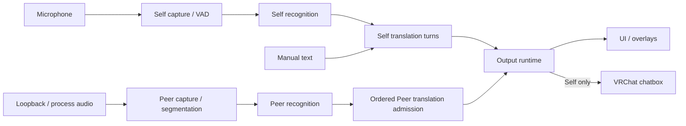

# Architecture

System map for PuriPuly Heart: who owns state, how work crosses boundaries, and where to read the implementation. For commands and result interpretation, see the [CLI guide](cli.md).

Keep this map about ownership, dependency direction, and cross-component invariants. Update the relevant section when a boundary changes; do not append fix histories, policy values, field catalogs, or test acceptance criteria. Those belong in the owning code and behavior tests.

## System Model

- One Python application runtime serves GUI and headless hosts. Presentation is an adapter, not a second runtime.
- Runtime owners hold state and resources; ports define their contracts; adapters connect UI, audio, providers, storage, and child processes.
- Composition constructs and connects owners. Core code must not depend on UI or composition code.
- The application owns capture, recognition, translation, and output. Native workers own native execution/rendering, not application policy.
- Broker provides managed identity, entitlement, and credential release. It is a control-plane dependency, not part of the normal utterance path.

[Application composition](../src/puripuly_heart/composition/application_runtime.py) loads settings and secrets, selects adapters, connects services, and installs startup/shutdown. Long-lived resources must transfer to explicit owners. The [runtime pipeline launcher](../src/puripuly_heart/app/wiring/wiring_runtime_pipeline.py) installs replaceable capture/provider/output components; callers must not retain them across replacement unless the API permits it.

Python callers use canonical module paths and the current package facades. Pre-grouping app/core import aliases and the synchronous `puripuly_heart.providers.llm.qwen` import are unsupported; Qwen translation uses the [asynchronous adapter](../src/puripuly_heart/providers/llm/qwen_async.py).

## Runtime Ownership

Paths below are navigation entry points, not an exhaustive class inventory.

| Area | Responsibility | Entry points |
| --- | --- | --- |
| Application boundary | UI intents; typed control operations, queries, and mutation ordering | [UI boundary](../src/puripuly_heart/app/services/ui_application.py), [control owner](../src/puripuly_heart/app/services/application_control.py) |
| Local control host | Authenticated endpoint and instance lifetime | [Host](../src/puripuly_heart/cli/host.py), [instance ownership](../src/puripuly_heart/core/control_instance.py) |
| Settings | Canonical intent, persistence, and runtime application coordination | [Persistence](../src/puripuly_heart/app/services/canonical_settings_persistence.py), [settings application](../src/puripuly_heart/app/services/settings/settings_application.py) |
| Capture | Source authority, audio ordering, segmentation, and capture lifecycle | [Self](../src/puripuly_heart/core/runtime/self_capture.py), [Peer](../src/puripuly_heart/core/runtime/peer_channel.py) |
| Recognition | Channel-scoped STT; shared local ASR resources and backend transitions | [Scoped engine](../src/puripuly_heart/core/stt/scoped_engine.py), [local ASR runtime](../src/puripuly_heart/core/runtime/local_asr_provider_runtime.py) |
| Translation | Self source progression; turn admission, cancellation, and publication authority | [Self channel](../src/puripuly_heart/core/orchestrator/self_translation_channel.py), [turn lifecycle](../src/puripuly_heart/core/orchestrator/translation_turn.py) |
| Provider requests | Request preparation and provider authority; provider replacement | [Request owner](../src/puripuly_heart/core/orchestrator/translation_request.py), [provider rebuild](../src/puripuly_heart/core/runtime/provider_rebuild.py) |
| Local models | Asset operations; managed translation server and model lifecycle | [Model assets](../src/puripuly_heart/app/services/model_assets.py), [Gemma runtime](../src/puripuly_heart/core/local_translation/runtime.py) |
| Output | Routing, independent destination delivery, and delivery history | [Output runtime](../src/puripuly_heart/core/runtime/output.py), [translation projection](../src/puripuly_heart/core/orchestrator/translation_output_projection.py) |
| Overlays | Target selection, logical captions, child lifecycle, and native rendering | [Application owner](../src/puripuly_heart/app/services/overlay/overlay_application.py), [Python runtime](../src/puripuly_heart/core/runtime/overlay.py), [native runtime](../native/overlay/src/runtime.rs) |
| Accounts | Managed authentication/credentials; separate ChatGPT session | [Managed wiring](../src/puripuly_heart/app/wiring/wiring_managed_account.py), [ChatGPT owner](../src/puripuly_heart/app/services/chatgpt_account.py) |
| VRChat integration | OSC control/state; independent scene-context observation | [OSC runtime](../src/puripuly_heart/app/services/osc/control_runtime.py), [scene owner](../src/puripuly_heart/core/vrchat_scene_service.py) |
| Diagnostics | Console/file/Logs delivery and bounded current-instance evidence | [Logging service](../src/puripuly_heart/app/services/application_runtime_logging.py) |
| Shutdown | Ordered teardown across owners | [Shutdown adapter](../src/puripuly_heart/app/adapters/application_runtime_shutdown.py) |

An owner may span several processing stages. GUI, CLI, and OSC mutations share application ordering and resource-conflict boundaries; operations belong to the application, not the requesting connection. Queries distinguish saved intent from effective runtime state. Presentation and notifications are never state authorities.

## Data Handoffs

### Capture and recognition

- Capture owns source order, timing, and audio scope. Audio loss is explicit, not silence; segmentation does not depend on provider readiness.
- Self and Peer share audio contracts but retain separate endpoint policies and recognition lifecycles. Local resources may be shared without sharing channel authority.
- Provider adapters translate native events into shared STT contracts. Local audio completion and transcript delivery are distinct; provider recovery stays inside the recognition boundary.
- Source completion drains admitted input. Stop, discontinuity, and replacement revoke affected authority so late results cannot enter current work.
- VAD-only audio tests exclude normal capture. The application owner handles admission, input release, and restoration of still-authorized capture.

Contracts: [audio ownership](../src/puripuly_heart/core/audio/ownership.py), [audio delivery](../src/puripuly_heart/core/audio/listen_delivery.py), [audio-test owner](../src/puripuly_heart/app/services/audio_test.py). Behavior: [scoped recognition tests](../tests/core/test_stt_scoped_engine.py).

### Local ASR ownership

- Orukeet and the two Fun-ASR CPU providers use the authenticated [ASR worker](../native/asr_worker/) through the existing [process adapter](../src/puripuly_heart/app/adapters/asr_worker_process.py). Each active channel owns a lazy worker, native Model and mutable Session, even for the same checkpoint. The installed file is reused; inference can overlap across channels. Each Session requests two inference threads, not a cap on process/helper threads. Japanese CTC retains its sherpa runtime.
- Canonical sherpa code and layout keys retain the existing physical `_runtime/local_qwen` directory for the ONNX Runtime DLLs still needed by Japanese CTC. This is current shared-runtime storage, not a retired CPU provider or weight bundle. No second cache path, legacy provider alias, or guessed-hash deletion is introduced.
- GPU ASR retains one shared worker and exactly one resident native Model, with independent channel Sessions and serialized compute. Replacement drains work and releases the previous Model before loading another. Releasing one channel must preserve the other channel's lease and Session.
- Channel generations fence cancelled or replaced results. Started native work remains owned until settlement; requesting cancellation does not authorize early Model/Session destruction.
- The [asset catalog](../src/puripuly_heart/core/local_asr/local_stt_catalog.py) owns language routing and readiness. CPU Auto requires its four current CPU assets; unsupported languages and missing assets do not select a retired, cloud or GPU fallback. The [CLI contract](cli.md#local-speech-recognition) describes migration and control behavior.

### Translation

- Provider adapters own provider-specific authentication, requests, streaming, and errors behind the common provider boundary. Turn owners own admission, cancellation, stale-result rejection, and publication.
- Self source closure and translation completion are independent. Speculative results are not accepted history; source/target revisions and turn identity govern presentation.
- Self and Peer have separate admission while sharing provider capacity. Peer execution may be concurrent, but context preparation and publication preserve admitted order.
- Manual text bypasses capture/STT and uses Self publication. Admission, translation completion, and destination delivery are separate outcomes.
- Managed local translation owns its server, model, and capacity behind the same provider boundary. Requests retain native resources until settlement; model/backend replacement drains work before admitting a replacement.

Behavior: [turn lifecycle](../tests/core/test_translation_turn_owner.py), [request ownership](../tests/core/test_translation_request_owner.py), [managed local runtime](../tests/core/local_translation/test_gemma_runtime.py). Model assets and execution profiles live in [assets.py](../src/puripuly_heart/core/local_translation/assets.py) and [runtime_profile.py](../src/puripuly_heart/core/local_translation/runtime_profile.py), not this map.

### Output and context

- Destinations have independent bounded delivery. One destination's failure must not block another or replay recognition/translation. Peer speech never reaches the chatbox; system disclosures require an explicit route.
- Output preserves turn/publication identity. Revisions may update retained turns without refocusing the dashboard or reviving retired captions. Preview presentation is separate from final accepted history.
- Python owns logical caption state and lifetime; native overlays own rendering. Presentation does not gate translation, and delivery receipts do not prove physical display or remote UDP receipt.
- The VRChat scene owner survives pipeline rebuilds and has no audio, VAD, or OSC dependency. Only trusted, sanitized population context reaches translation; names/raw logs stay local, and custom HTTP extensions receive no scene data.

Behavior: [output runtime](../tests/core/runtime/test_output_runtime.py), [caption policy](../tests/core/test_self_caption_policy.py), [overlay presenter](../tests/core/test_overlay_presenter.py). Protocols: [native overlays](../native/overlay/README.md), [VRChat OSC](vrchat-osc.md), [HTTP extensions](http-extensions.md).

## Settings and Credentials

| State | Authority |
| --- | --- |
| Persisted intent | Settings owner and canonical persistence |
| Resolved configuration | [Resolution](../src/puripuly_heart/config/resolved.py) and [runtime selection](../src/puripuly_heart/config/runtime_resolution.py) |
| Effective runtime state | The owner of the active resource or operation |

- UI surfaces consume frozen snapshots and emit focused typed intents. The settings owner rebases changes onto current canonical state and serializes commit/rollback; observers publish afterward in commit order.
- Persistence and runtime application are distinct. Runtime effects cannot assign canonical settings; failed application must remain degraded/retryable rather than appear applied or silently undo durable intent.
- Capture-target application uses Peer-owned runtime convergence to classify the result. Saved intent with requested capture still pending is degraded, not applied; intentionally disabled capture does not require an active source for successful application.
- GUI autosave coalesces the latest submitted intents and attempts each generation once, without timed retries or a recovery-specific notification surface. Unsaved, reverted, and unknown-outcome edits remain dormant in page memory until the affected setting is explicitly resubmitted. Saved-but-unapplied edits are acknowledged as saved without scheduling a runtime-only replay. Unrelated edits and navigation without a new draft do not restart failed submissions.
- Prompt commits supersede queued or in-flight prompt edits, including restoration of the saved value and prompts merged with provider changes. Older completions cannot discard newer edits or replace their editor presentation. The application boundary returns an attempt-scoped persistence/application outcome; the page owns the settings queue and stops it at shutdown.
- Transactional application uses the current committed snapshot. Explicit runtime-only overrides remain ephemeral and retain their admitted configuration throughout resource construction/recovery.
- Retired CPU ASR identifiers normalize to current intent before canonical persistence. Recoverable persistence is necessary but not sufficient for [recognized old-asset cleanup](../src/puripuly_heart/core/local_asr/retired_cpu_assets.py): only initial `SettingsOwner.start` explicitly authorizes it, before native providers are constructed. Ordinary reloads, telemetry verification and repeated same-owner starts remain nondestructive. Cleanup holds the provisioning lease, preserves unknown contents/reparse targets, never restores retired backups, and retries pending deletion at later application startups. It does not claim ownership of other running applications.
- Secret-store instances observe one backend, not independent credential snapshots. Mutations preserve unrelated entries across instances/processes; unreadable storage is unknown state, not proof of absent credentials.
- Managed identity authority belongs to the settings owner. Credential storage, remote acknowledgment, authentication completion, and provider activation are separate transitions. Modern credentials require matching durable delivery proof and canonical authority; recovery resumes the same operation rather than issuing a replacement on uncertainty.
- ChatGPT authentication is separate from Broker and survives provider replacement. Refresh credentials use the secret store; access tokens remain in memory.

Entry points: [provider application](../src/puripuly_heart/app/services/provider/provider_runtime_apply.py), [secret storage](../src/puripuly_heart/core/storage/secrets.py), [managed authentication](../src/puripuly_heart/app/services/managed/), [credential proof](../src/puripuly_heart/core/managed_credential.py). Behavior: [control contract](../tests/app/test_application_control_contract.py), [provider application](../tests/app/test_stt_provider_apply_vertical.py), [secret persistence](../tests/core/test_encrypted_secret_store.py).

## Lifecycle and Concurrency

- Every task, source, process, and provider session has an owner before work starts. That owner stops ingress, cancels or drains work, rejects late callbacks, and releases resources.
- Generations, attachment tokens, and request identities fence retired work. Replacement revokes old authority; retired resources remain owned until cleanup completes. Caller cancellation is not proof that native/thread/process work settled.
- Application state and async clients stay on the Python event loop. Blocking device/model/storage/startup work uses owned threads, executors, or child processes; [owned-thread cancellation](../src/puripuly_heart/core/owned_thread.py) drains started synchronous work before resource release.
- Events cross ports, callbacks, or owned queues. Receivers mutate their own state. Ordering is local to the owner/channel, not global across UI, Self, Peer, and providers.
- Matching stops may preempt pending starts, while cleanup fences older queued starts and later replacements. Removing one channel's demand does not revoke another channel's shared resource.
- Shutdown freezes ingress and startup, drains/cancels owned work, closes external resources, then clears runtime references. Primary operational failures and secondary cleanup failures remain distinct; failed cleanup stays owned and visible.

[Dependency checks](../tests/architecture/test_dependency_boundaries.py) enforce import boundaries and record narrow pre-existing localization and application-wiring exceptions. These exact-edge exceptions do not permit additional dependencies from the same modules. [Task-ownership checks](../tests/architecture/test_lifecycle_task_guard.py) record reviewed creation sites and remaining lifetime debt. These structural checks do not prove runtime draining or cleanup; owner behavior tests do.

## Diagnostics and Runtime Layout

- Owners produce typed causes and known operation/request/turn identities before reducing them to user messages. [Diagnostics](../src/puripuly_heart/core/diagnostics.py) and [runtime logging](../src/puripuly_heart/core/runtime_logging.py) validate and project that evidence; arbitrary exception prose is not a classification source.
- Technical diagnostics exclude credentials, conversation content, audio, arbitrary child output, and personal paths. Accepted conversation records have a separate protected path; CLI content requires explicit opt-in.
- History, subscribers, and file delivery are bounded. Loss and cleanup failure remain observable independently of a failed sink. Enqueued, written, durable, and physically displayed are different claims; current-instance history is not a durable audit. See [CLI diagnostics](cli.md#retained-diagnostics-and-delivery-health).
- [Runtime layout](../src/puripuly_heart/runtime_layout.py) separates interpreter/host paths, immutable resources, and writable user data. Windows distributions use the native host; source/developer execution remains supported. The PyInstaller packaging backend is unsupported. Features use this boundary rather than the working directory or launcher flags. Packaged code changes require rebuilding the payload; startup never writes into installed directories.
- Model registries own pinned sources and integrity contracts. Provisioning validates owned staging before atomic replacement. Explicit asset operations have their own cancellation lifetime, separate from runtime demand. See [ASR installation](../src/puripuly_heart/core/local_asr/local_stt_runtime_installer.py) and [translation provisioning](../src/puripuly_heart/core/local_translation/provisioning.py).
- Windows Setup provisions the same four required CPU ASR models through [shared installer code](../installer/local-asr.iss). Its [build-time generator](../src/puripuly_heart/release_evidence/local_asr_installer.py) reads the canonical model manifests and settings schema, pins the final packaged manifest bytes, and emits the Inno include. Setup and Python share the same provisioning byte-range lease and staged integrity contract. Old worker cleanup uses exact prior-inventory hashes and verified current-artifact exclusions; modified, in-use or unowned bytes remain protected and retryable.

Behavior: [runtime logging](../tests/core/test_runtime_logging.py), [output diagnostics](../tests/core/test_output_logging.py), [packaged layout](../tests/release_evidence/test_native_runtime_layout.py), [model provisioning](../tests/core/local_translation/test_gemma_provisioning.py).
