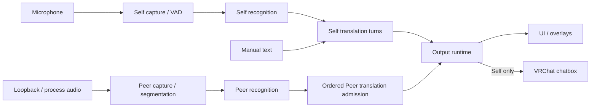

# Architecture

System map: state ownership, component boundaries, and implementation entry points. For commands, see the [CLI guide](cli.md).

Keep ownership and cross-component rules here. Put implementation details in code and tests, not this map.

## System Model

- GUI and headless hosts share one Python runtime. Presentation is an adapter.
- Owners hold state and resources. Ports define contracts; adapters connect external systems.
- Composition connects owners. Core code must not depend on UI or composition.
- Python owns application policy. Native workers own inference and rendering.
- Broker owns managed identity, entitlement, and credential release. Speech requests do not pass through Broker.

[Application composition](../src/puripuly_heart/composition/application_runtime.py) connects services and installs startup/shutdown. The [pipeline launcher](../src/puripuly_heart/app/wiring/wiring_runtime_pipeline.py) replaces capture, provider, and output components. Do not retain replaced components beyond their API's lifetime.

## Runtime Ownership

Paths below are navigation entry points, not an exhaustive class inventory.

| Area | Responsibility | Entry points |
| --- | --- | --- |
| Application boundary | UI intents; typed control operations, queries, and mutation ordering | [UI boundary](../src/puripuly_heart/app/services/ui_application.py), [control owner](../src/puripuly_heart/app/services/application_control.py) |
| Agent conversation | Conversation lifetime, context, and tool dispatch | [Chat owner](../src/puripuly_heart/app/services/agent_chat/owner.py), [context](../src/puripuly_heart/app/services/agent_chat/context.py) |
| Local control host | Authenticated endpoint and instance lifetime | [Host](../src/puripuly_heart/cli/host.py), [instance ownership](../src/puripuly_heart/core/control_instance.py) |
| Settings | Canonical intent, persistence, and runtime application coordination | [Persistence](../src/puripuly_heart/app/services/canonical_settings_persistence.py), [settings application](../src/puripuly_heart/app/services/settings/settings_application.py) |
| Capture | Source authority, audio ordering, segmentation, and capture lifecycle | [Self](../src/puripuly_heart/core/runtime/self_capture.py), [Peer](../src/puripuly_heart/core/runtime/peer_channel.py) |
| Recognition | Channel-scoped STT; shared local ASR resources and backend transitions | [Scoped engine](../src/puripuly_heart/core/stt/scoped_engine.py), [local ASR runtime](../src/puripuly_heart/core/runtime/local_asr_provider_runtime.py) |
| Translation | Channel admission, cancellation, and publication | [Self](../src/puripuly_heart/core/orchestrator/self_translation_channel.py), [Peer](../src/puripuly_heart/core/orchestrator/peer_caption.py), [turns](../src/puripuly_heart/core/orchestrator/translation_turn.py) |
| Provider requests | Request preparation and provider authority; provider replacement | [Request owner](../src/puripuly_heart/core/orchestrator/translation_request.py), [provider rebuild](../src/puripuly_heart/core/runtime/provider_rebuild.py) |
| Local models | Asset operations; managed translation server and model lifecycle | [Model assets](../src/puripuly_heart/app/services/model_assets.py), [Gemma runtime](../src/puripuly_heart/core/local_translation/runtime.py) |
| Output | Routing, independent destination delivery, and delivery history | [Output runtime](../src/puripuly_heart/core/runtime/output.py), [translation projection](../src/puripuly_heart/core/orchestrator/translation_output_projection.py) |
| Overlays | Target selection, logical captions, child lifecycle, and native rendering | [Application owner](../src/puripuly_heart/app/services/overlay/overlay_application.py), [Python runtime](../src/puripuly_heart/core/runtime/overlay.py), [native runtime](../native/overlay/src/runtime.rs) |
| Photo translation | Capture, authorization, requests, and native child lifecycle | [Application owner](../src/puripuly_heart/app/services/photo_application.py), [photo lifecycle](../src/puripuly_heart/core/photo/lifecycle.py), [native role](../native/overlay/src/photo/) |
| Accounts | Managed authentication/credentials; separate ChatGPT session | [Managed wiring](../src/puripuly_heart/app/wiring/wiring_managed_account.py), [ChatGPT owner](../src/puripuly_heart/app/services/chatgpt_account.py) |
| VRChat integration | OSC control/state; independent scene-context observation | [OSC runtime](../src/puripuly_heart/app/services/osc/control_runtime.py), [scene owner](../src/puripuly_heart/core/vrchat_scene_service.py) |
| Diagnostics | Console/file delivery and current-instance evidence | [Logging service](../src/puripuly_heart/app/services/application_runtime_logging.py) |
| Shutdown | Ordered teardown across owners | [Shutdown adapter](../src/puripuly_heart/app/adapters/application_runtime_shutdown.py) |

GUI, CLI, and OSC share mutation ordering and resource-conflict boundaries. Operations belong to the application, not the requesting connection. Presentation reads owner state; it never owns runtime authority.

## Data Handoffs

### Capture and recognition

- Capture owns audio order, timing, and segmentation. Self and Peer retain separate recognition lifecycles.
- Provider adapters convert native events to shared STT contracts. Recognition recovery stays within that boundary.
- Audio tests and diagnosis share an owner and exclude normal capture.

Contracts: [audio ownership](../src/puripuly_heart/core/audio/ownership.py), [delivery](../src/puripuly_heart/core/audio/listen_delivery.py), [audio tests](../src/puripuly_heart/app/services/audio_test.py).

### Local ASR ownership

- CPU workers own per-channel models and sessions. GPU ASR shares one resident model, with separate channel sessions and serialized inference.
- Releasing one channel preserves the other's resources. Model replacement waits for started work to settle.
- The [ASR catalog](../src/puripuly_heart/core/local_asr/local_stt_catalog.py) owns language routing and readiness. The [process adapter](../src/puripuly_heart/app/adapters/asr_worker_process.py) connects native workers.

### Translation

- Providers own authentication, transport, and errors. Turn owners control admission, cancellation, and publication.
- Self and Peer admit work independently and share provider capacity. Previews remain separate from accepted history.
- Manual text bypasses capture/STT and enters the Self path.
- [Managed local translation](../src/puripuly_heart/core/local_translation/runtime.py) owns its server, model, and request capacity.

### Output and context

- Destinations deliver independently. One failure cannot block another or replay translation. Peer speech never reaches the chatbox.
- Output preserves turn identity across revisions. Python owns caption lifetime; native code renders it.
- The scene owner observes VRChat independently of audio and OSC. Only sanitized population context reaches translation.

Interfaces: [native overlays](../native/overlay/README.md), [VRChat OSC](vrchat-osc.md), [HTTP extensions](http-extensions.md).

### Isolated photo requests

- Photo translation has its own application owner and native process, separate from captions.
- Python owns authorization, provider requests, and retention. Native code owns pixel processing and VR interaction.
- Image upload requires an authorized pull. Photo requests reuse account/network owners without sharing speech sessions.
- Renderer recovery does not restart provider requests. Photo, attempt, and renderer identities reject late results.

Contracts: [photo bridge](../src/puripuly_heart/core/photo/bridge.py), [providers](../src/puripuly_heart/providers/photo.py), [native photo boundary](../native/overlay/README.md#photo-runtime-boundary).

### Agent conversation

- Python owns conversations and tool execution. Relay owns model requests, instructions, and tool definitions. Broker supplies installation authentication.
- Context is an allowlisted view of application state. Tools use existing application owners and cannot expand their permissions.
- Settings changes require approval. Cancellation discards unapproved work, not committed changes.
- Credentials use secure app controls, not chat. Support uploads require a user click.

Service contract and development: [Agent relay](../agent-relay/README.md).

## Settings and Credentials

| State | Authority |
| --- | --- |
| Persisted intent | Settings owner and canonical persistence |
| Resolved configuration | [Resolution](../src/puripuly_heart/config/resolved.py) and [runtime selection](../src/puripuly_heart/config/runtime_resolution.py) |
| Effective runtime state | The owner of the active resource or operation |

- Settings owners serialize commits. UI consumes snapshots and submits typed intents.
- Persistence and runtime application are separate. Runtime failure cannot silently undo saved intent.
- Secret storage preserves unrelated entries. A read failure means unknown state, not absent credentials.
- Managed authentication separates local persistence, remote acknowledgment, and activation. Recovery resumes the same operation.
- ChatGPT authentication is separate from Broker and survives provider replacement.

Entry points: [provider application](../src/puripuly_heart/app/services/provider/provider_runtime_apply.py), [secret storage](../src/puripuly_heart/core/storage/secrets.py), [managed authentication](../src/puripuly_heart/app/services/managed/).

## Lifecycle and Concurrency

- Every task, source, process, and session has an owner before work starts.
- Stop and replacement revoke old authority. Generations and request identities reject late results.
- Cancellation is not cleanup. Started native, thread, and process work stays owned until settlement.
- Async orchestration runs on the Python event loop. Blocking work uses owned threads or child processes.
- Ordering is local to each owner/channel. Shared resources remain alive while another channel needs them.
- Shutdown stops ingress, settles work, and releases resources. Cleanup failures remain visible and owned.

Checks: [dependencies](../tests/architecture/test_dependency_boundaries.py), [task ownership](../tests/architecture/test_lifecycle_task_guard.py). Blocking-work contract: [owned threads](../src/puripuly_heart/core/owned_thread.py).

## Diagnostics and Runtime Layout

- Owners produce typed causes and operation identities. Technical diagnostics exclude secrets and conversation content; conversation logs use a separate path.
- Diagnostic history and delivery queues are bounded. Use [CLI diagnostics](cli.md#retained-diagnostics-and-delivery-health) to inspect failures and gaps.
- [Runtime layout](../src/puripuly_heart/runtime_layout.py) separates installed resources from writable user data. Windows uses the native host; source execution remains supported.
- Model registries own asset identity. Setup and Python provisioning install assets; native workers consume supplied paths.

Entry points: [diagnostics](../src/puripuly_heart/core/diagnostics.py), [runtime logging](../src/puripuly_heart/core/runtime_logging.py), [ASR provisioning](../src/puripuly_heart/core/local_asr/local_stt_runtime_installer.py), [translation provisioning](../src/puripuly_heart/core/local_translation/provisioning.py).
