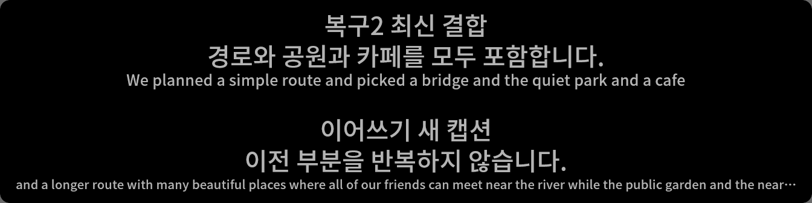

# Issue 356 verification

## Candidate and scope

Latest implementation checkpoint: `2b6e18783e3eb4dad3c876dc53bfbe74aa05a962`, based on `787e66347f7ca3b2430b21c3fce070d8d8b3e610` (`dev`). The complete local Python partition run was on `98919abbd7d73c8e33612bafc8e557a2a7ea4fdb`. The initial checkpoint was `16099940b19e4b8f20b4218c916e6770cc40a3d3`; the main repair/application-observation checkpoint was `37b9a03e393e8e00c590ea828012ea2adc30e75e`. The starting worktree was clean; the historical uncommitted #278 prototype was not present in this worktree.

The selected F′P/RP-B′ policy was implemented without another policy comparison or threshold tuning. Existing speaker/language source children, local per-final translation, Self/manual input and output isolation remain requirements. Known speaker disagreement across a rule-selected merge uses existing mixed semantic attribution; it does not add another join stop.

## Completion status

[PR #357](https://github.com/kapitalismho/PuriPuly-heart/pull/357) delivers the implementation and its evidence record; it references rather than closes #356. Independent completion review identified two outstanding obligations:

- Current readable application output, including local paging, is not qualified by the gray/black window captures or renderer acknowledgments.
- The small actual-application baseline-versus-selected comparison explicitly transferred by [#278's owner closing decision](https://github.com/kapitalismho/PuriPuly-heart/issues/278#issuecomment-6580384532) has not run. It requires an actual translation route, suitable permitted inputs/service access and usable visible observation. Synthetic translations and the historical replay results are not substitutes.

These are completion blockers, not a request to retune the selected policy or rerun the 424-cell study. Missing service authority and presentation prerequisites require resolution or an explicit owner revision of completion scope; unavailable-route reporting alone does not waive them.

## Executed checks

| Check | Result |
| --- | --- |
| Python Contracts: `tests/domain tests/config tests/core`, two file-grouped workers | 4,377 passed; 4 opt-in real-process tests skipped |
| Python Runtime: `tests/app`, two file-grouped workers | 2,289 passed; 3 opt-in real-process tests skipped |
| Architecture, Providers, UI, Tooling: `tests/architecture tests/providers tests/ui tests/scripts tests/cli tests/release_evidence` | 3,206 passed; 10 skipped |
| PR workflow's five selected real-process overlay checks, `INTEGRATION=1` | 5 passed, zero skipped |
| `uv run --locked ruff check .` | Passed |
| `uv run --locked black --check .` | Passed |
| `uv run --locked python scripts/ci/check_test_selection.py` | 526 offline files covered; 10 intentionally excluded live/opt-in integration files |
| Native `cargo check --locked` | Passed |
| Native deterministic tests, excluding `windows_graphics_` | 229 passed |
| Native Windows graphics tests, serial | 25 passed |
| Native release build and assembled `--check-startup-contract` | Passed; app 2.10.0, contract 16; unchanged native component |

The Python runs above executed on `98919abbd`, for **9,877 passing checks** including the five explicit real-process checks. Those five cover subprocess dispatch without provider/secret/STT construction, acknowledged shutdown before reader cleanup, Windows owned-process cleanup and ten-cycle Flet child reaping. The remaining ordinary-suite skips include four other opt-in process checks and eight installer tests requiring Inno Setup >=7.1; they are not passes. No Python static type-checker run is claimed. Native source and binary surfaces did not change after their recorded check/test/build runs; those results are retained, not described as another execution on the final Python checkpoint. Dependency deprecation warnings and the existing Rust `Atomic::fetch_update` deprecation warning remain.

Full Python partition reproduction uses the commands in `.github/workflows/pr-ci.yml`. The final local run executed partitions sequentially rather than competing for the same host's CPU. Native commands and font staging follow `native/overlay/README.md`.

## Repaired-candidate actual application

The actual application was observed at `37b9a03e393e8e00c590ea828012ea2adc30e75e`, with stable imported-source hashes. A real hosted application, supported CLI, production Peer owner, request preparation, output writer, presenter, authenticated Desktop bridge, actual Flet child and runtime logging were used. Recognition was synthetic and translation deterministic. Native Gemini callback authority was narrowly controlled for owned synthetic identities. No live-service or translation-quality claim follows.

The actual-window run completed five high-risk case groups. Two unsuccessful groups were retained, not hidden by its successful process cleanup. One separately authorized, no-window real `HostedApplication` then completed only the three narrower logical cases described below.

| Boundary | Observed result |
| --- | --- |
| Unsupported language | Unsupported span settled source-only; supported sibling and successor translated; bounded drain completed |
| Native empty terminal / epoch retirement | Obsolete provisional state and order entries cleared; no withdrawn request; valid successor committed |
| Preview to failed final | Revision 2 retained `Correct authoritative source.` with empty translation; old preview translation absent |
| Failed absorbing repair | Complete `A, second,` source-only replaced U; incoming preview retired; latest history cleared the obsolete translation |
| Queued-preview preemption | Ready repair's actual presenter receipt followed in 5.606 ms; obsolete preview was superseded rather than admitted |
| Same-unit W across final supersession | Final applied 1.003 seconds after the original preview admission attempt, including scheduling, rather than starting another full W at final readiness |
| Chained history and semantic attribution | One latest LogsView row for `The preceding, second, third.`, revision 3; current attribution mixed, obsolete range/revision cleared, first-readable cyan style retained |
| Isolated Soniox / Qwen completion | No withdrawn Soniox preview; Qwen retained its last nonempty preview; both authoritative successors admitted and segments settled |
| Effective layout scale | Direct production presenter calibration at 1.2 flowed through the real layout port; the unchanged estimator selected continuation and the expected instruction/context |

All times above are software receipt/scheduling observations, not physical-visible latency. The no-window completion makes no timing/performance claim.

History was observed beyond the context list: a forwarding sink received actual `ConversationRecord` objects from the real session logging service and awaited completion. Headless history delivery was additionally routed through production `AppHistoryEventDestination` into an actual, unmounted `LogsView`; its current model held one merged row. Persisted logs were inspected after flush/shutdown and contained explicit initial commit and replacement records, source plus translation at revisions 1, 2 and 3. Previews were absent; source-only repair cleared the previous translation. This qualifies logical materialization and audit delivery, not visible dashboard-history pixels.

The first unsuccessful group incorrectly put Soniox and Qwen synthetic segments in the same generation and awaited Qwen before terminating its Soniox predecessor. Its 8.335-second timeout is an adapter-ordering limitation, not a passing successor check; the isolated completion settled each route before starting the next. The second group used supported calibration controls: begin/change applied, but apply returned terminal `degraded / settings_commit_success_runtime_degraded` after credential-free Self Soniox replacement failed. The receipt and independent parent snapshot reached scale 1.2, but the applied-only adapter guard stopped before join injection. That operation remains degraded. The later continuation used the direct `OverlayPresenter.update_calibration` API and an explicitly disconnected transport; it does not upgrade the supported operation's result.

The current actual-window attempt did **not** establish readable pixels. Both a supported nonempty Self marker and a failed-repair Peer source-only scene were correlated through the current sink/presenter, authenticated bridge and actual child's matching enqueue/dispatch/render-return. Guarded screen-DC and HWND-DC images were uniformly RGB(105,105,105); PrintWindow was black. No second window, repaint workaround or speculative product patch was attempted. The precise native-composition/capture/environment cause remains unresolved.

Both application instances closed, the focused presenter was detached/closed, observability queues drained, no owned descendants remained, and supported post-stop queries returned `instance_not_found`. No imported product file changed during either run.

The later `98919abbd` change only restores first-readable assignment semantics for **unversioned** Peer/local updates. Independent review confirmed that every positive-revision branch exercised above is unchanged, as is first-readable local initialization. The new legacy boundary received separate presenter smoke and regression coverage; the 37b observations are retained by that applicability analysis, not relabeled as executions on 989.

## Earlier actual-window policy observation

The initial full policy observation used the real composed application, authenticated control endpoint, request preparation, output projection, presenter, Desktop bridge and Flet 1.0.5 renderer. Provider events and translation responses were controlled; neither microphone/loopback capture nor a paid service was used. Fourteen cropped captures show only the owned 1344×336 overlay window over an owned backdrop.

Fresh user/runtime directories, a synthetic encrypted secret store, disabled telemetry/integrated context/OSC, explicit existing Flet client selection, current-checkout imports and a loopback-only Python network guard isolated the run. This is not an OS-level network audit of native Flet. Supported CLI `capabilities` and `app status` returned successfully; overlay/translation/manual-input operations completed with applied receipts. Both capture channels remained inactive. Shutdown completed with no owned descendants, and the supported post-stop query returned `instance_not_found`.

| Observed transition | Evidence |
| --- | --- |
| First preview | Request 5.002 s after the first nonempty partial; readable lower-slot caption |
| Refresh | Same unit's second request at 9.003 s; visible first page replaced |
| No growth | Request count stayed 2 through the 13-second check; no preview history |
| Final settlement | First-page projection 2.651 ms after final ingress; sampled readable capture 0.372 s after ingress |
| Paging | First final page interval 3.014 s; visible continuation paging also observed |
| Merge and absorption | Incoming preview retired when repaired U appeared; one merged translation-context entry |
| Out-of-order repairs | Revision 5 completed before revision 4; saved captures retained the identical latest source/translation |
| R0 continuation | Repaired U remained upper; continuation entered lower with U's complete source last in context |
| R1-only continuation and W | Protected upper caption visible before admission; successor admitted at 1.010 s including event-loop scheduling |
| R1-only above four lines | Ordinary final request, not continuation; later sampled visible source retained |
| Self interaction | Manual Self projection 2.472 ms after its translation request and visible below Peer; no Peer-protection wait |

Request roles were 3 previews, 4 finals, 2 repairs and 2 continuations, plus one Self request. The in-memory translation-context history stayed empty during previews, represented the merge once, added continuations once and remained capped at five. This observation did not qualify the separate GUI-history or conversation-log consumers. No request contained both special prompt sections.

These are software-boundary times and sampled pixels, not exact photon onset, live provider performance or a reproduction of the 424-cell benchmark. The synthetic request counts do not estimate the historical 27% amplification or 8% late-cell rate.

This full visible run preceded a diagnostics-retention change and the later attributed-source compatibility repair. Its imported-file hashes were stable during execution. The compatibility repair subsequently passed 370 focused contracts and a fresh composed smoke covering multi-span settlement, attributed sibling failure/timeout recovery and honest mixed-source repair metadata. Its uniform-gray captures were not visual proof. The checkpoint's independent reviews subsequently found additional lifecycle/history defects; the original passing suites and images do not establish closure of those findings.

The following cropped images are from that **earlier synthetic run**, not the final candidate and not real LLM translations.

## Actual local recognition and physical-presentation limit

A focused local smoke exercised the real `local_granite` production factory, local runtime, scoped recognition engine, authenticated native worker, callbacks and ordinary per-final Peer request/output path. Controlled boundaries were file/VAD ingress, owned model/worker path selection and deterministic translation. Physical microphone/loopback capture, private state and real LLM translation were not used.

The pinned Granite Speech 5.0 470M TurboCTC multilingual Q8_0 model ran on CPU with two inference threads. The staged model was 505,663,136 bytes, SHA-256 `f3efdc05b85b3a764bb5bb7022e69f61cafcecc11605c881c6396a6ed07ec91b`; all fourteen native-worker inventory files were verified. Input was a public AMI Edinburgh IHM excerpt, `ihm-test-AMI_IS1009c_H02_FIO084_0095434_0095628`, CC-BY-4.0, AMI Consortium; Carletta et al. (2005), dataset revision `46f28f2503e2ec48f8867a84eef356c70476beab`.

Actual native recognition of the 1.94-second, 16-kHz mono PCM clip returned `It it it's not a high voltage battery.` The request took 0.247 seconds; worker-reported decoding took 0.243 seconds. One ordinary local final request, revision 0, carried that exact source. One in-memory context entry resulted. All cloud-policy request counters remained zero, and neither special prompt instruction was present. These are one-clip observations, not a performance benchmark. The parent logical page interval was 3.012 seconds; visible latency was unavailable.

The local overlay captures were genuinely uniform gray. A subsequent bounded nonempty Self-marker diagnostic reached the actual child but still produced no readable pixels, the same qualification boundary later retained in the repaired-candidate observation above. Its earlier empty-window gate was inconclusive, and a task-local accessor error was corrected before the decisive probe. Neither became a speculative product patch or a claim of local physical paging.

All captures were limited to the owned 1344×336 window over an owned backdrop, with PID/visibility/point-ownership guards. Each instance and native worker shut down; no owned descendants remained, and the supported post-stop query returned `instance_not_found`. Copied model, worker and PCM staging was removed without changing shared assets.

## Independent presentation-prerequisite diagnosis

A minimal native Flet control, without any PuriPuly imports, provider, audio or credentials, tested the observation prerequisite separately. It used Python 3.14.10 and the same existing Flet/Flet Desktop 1.0.5 client on Windows build 26300, fresh isolated state, an owned window/backdrop and a loopback-only Python guard.

The first native screenshot RPC rejected integer `pixel_ratio=1`; one corrected repeat used `1.0`. Native layout reported the expected control and viewport, and the corrected matching RPC returned a readable 640×200 red control with white and yellow text. Flet 1.0.5's implementation wraps a normally mounted visible child, not an intentionally offscreen-only widget. The bitmap still does not prove that the window presented it.

| Observation boundary | Result |
| --- | --- |
| Native session, layout and widget screenshot | Connected; matching method completed and returned readable native-rendered pixels |
| Guarded screen DC, HWND DC and PrintWindow | Known control absent; window body remained white |
| Distinct GPU-aware Windows.Graphics.Capture | Supported hardware D3D11 device and exact-owned-HWND capture succeeded; one GPU frame showed the correct title/chrome but a white body, with no known control. No subsequent frame arrived before the eight-second bound; the terminal timeout remains a failed observation |
| Subsequent metadata-only desktop/session check | `WinSta0`, active input `Default`, accessible input desktop and active console session; no API failure. This is not retrospective proof of presentation health |

The exact-window probe used documented `IGraphicsCaptureItemInterop.CreateForWindow`, not monitor or full-desktop acquisition. A GDI-only explanation is insufficient, but native presentation, visual attachment, composition and shared observation behavior are not conclusively separated. No product defect, driver/environment cause, inactive-desktop cause or human-visible result is inferred.

No product-policy retry, rendering-backend guess, repaint workaround or settings change followed. Owned windows, capture/session/device resources and processes closed; staged public WinRT dependencies and fourteen throwaway Python adapters were removed. Reports, images, logs and all earlier failures remain retained. A working readable-window prerequisite is still missing; this investigation does not close either completion obligation.

## Focused audio and prompt evidence

A controlled run of the actual controller, segment ledger, scoped recognition engine and production retention profile showed all four named cloud routes remaining open at 6 seconds and sealing at 10 seconds with 160,000 owned samples. Local CPU Auto and local GPU retained their 6-second boundary. The original shared retention bounds were sufficient and returned to zero retained bytes. This used synthetic capture time and a controlled provider, not live transport timing.

Before rendering changes, ordinary prompt outputs were captured in memory. All 108 ordinary combinations remained byte-identical afterward. Renderer checks covered preview omission of the Ellipsis line, exact editable request instructions, mutually exclusive sections and no extra empty section. Missing/empty opted-in custom instructions fail the affected request rather than silently remove its semantics; ordinary and legacy custom rendering remain supported.

## Independent-review repairs

Two independent reviews of the initial checkpoint found defects not caught by its passing suites. Every finding was accepted and repaired; no finding was deferred as a policy change:

- Unsupported detected-language preparation now retains the existing source-only disposition without dropping supported siblings, blocking a later final or leaving drain dependent on an unset admission event.
- Native Gemini empty completion and epoch retirement cancel and retire the affected provisional unit, release publication dependencies and reject obsolete partials without discarding accepted final history.
- Failed or timed-out cloud finals and repairs carry the same explicit revision/absorption authority as successful settlement. Authoritative source-only output clears the old preview translation, including when secondary originals are hidden.
- Only Qwen retains the last nonempty partial. Other cloud routes honor full retractions, including cancellation of withdrawn running or queued previews.
- The output owner can cancel a superseded preview already waiting for a protected slot. A ready repair of a visible caption does not wait behind it, and unrelated final ordering remains intact.
- Superseding a waiting preview with its final preserves the caption's first actual admission-attempt time. The composed check starts waiting at 5.0 seconds, completes the final at 5.6 seconds, remains pending at 5.99 seconds and admits at 6.0 seconds—not 6.6 seconds.
- Accepted repairs update current semantic speaker attribution, source range and source revision while preserving first-readable style. The overflow divider no longer relies on obsolete single-speaker provenance.
- Join estimation consumes current effective caption text scale through the same layout boundary as pagination.
- Runtime conversation records and both GUI-history delivery paths now share stable caption identity and monotonic revision. The visible-history model replaces the logical contribution; the append-only audit explicitly labels `commit`/`replace` revisions. A current source-only revision clears an older translation; stale/duplicate deliveries cannot restore it.

Focused repaired-path checks passed. A separate fresh-process controlled composition exercised eight lifecycle/output boundaries, produced 24 publication records and closed all eight owned harnesses with stable imported-source hashes and no network denials. It used actual owners, request preparation, output and presenter, but controlled recognition/translation and the native callback's current-stream predicate. It did not launch the application host or qualify pixels, live providers or persistence across restart.

Both independent reviewers verified the main repair checkpoint and retained unaffected baseline coverage. Final integration then exposed one legacy attribution boundary, corrected by `98919abbd` and independently re-verified. That guard preserves unversioned first-readable semantics without altering positive-revision behavior. The subsequent Codex findings and their separate repair evidence follow.

## Post-publication code-review repairs

Codex found two additional P2 defects at published checkpoint `9ccf9f3086f093b4f456819deac53e3d6e46056d`. Both were independently traced, accepted and corrected in `2b6e18783`:

- A nonempty final with no canonical source fragments previously completed without retiring its provisional segment. It now uses existing authoritative retirement before normal completion. The canonical segmenter is unchanged; no punctuation-string special case was added.
- Join classification used the preceding caption's detected language, but expansion estimation used the configured fallback even when detection existed. Both now use the same detected-or-configured preceding language. Request source-language authority, target language, ratios, thresholds and effective calibration remain unchanged.

The affected lifecycle/request/output/layout and neighboring suites passed **489 checks**, including nine new boundary cases. An originating independent reviewer verified the exact two-file repair and executed **15 focused checks** covering the new cases plus existing empty/epoch retirement and calibration boundaries. No existing assertion, tolerance, skip or expected outcome was weakened.

A fresh-process composition exercised the real Peer owner, request preparation, output runtime and presenter with controlled recognition and deterministic translation. Seven scenarios produced 21 versioned publications, and all seven harnesses closed with zero open segments, caption tasks or pending admission clocks. Repeated zero-fragment finals before and after shown previews retired once, rejected obsolete updates, preserved valid successor publication and left no provisional history. Detected-language decisions crossed the real estimator's boundaries:

| Detected Korean, stored English, target English | Detected-language estimate | Stored-English estimate | Actual corrected request |
| --- | --- | --- | --- |
| R0 above two lines | 2.298 | 1.421 | Continuation |
| R1-only above two lines | 2.377 | 1.470 | Continuation |
| R1-only above four lines | 4.315 | 2.668 | Independent normal final |

Absent detection retained the configured-language outcomes: Korean continued, English repaired with the original context. Imported-source hashes remained stable and the loopback-only Python guard recorded no denials. The throwaway script was removed. This smoke did not launch the application host or qualify GUI pixels, live services or either outstanding completion obligation. Ruff and Black passed after formatting the new test code; the earlier 9,877-check partition result is not relabeled as an execution on this repair.

## Failures retained and corrected

- Full integration found a genuine cloud final regression: existing speaker/language child splitting and allocator metadata were bypassed. The repair reuses the existing builder, preserves exact source spans and whitespace, snapshots per-request attribution, and restores successful sibling/source-only/timeout recovery. All original meaningful attribution assertions were retained.
- The first repaired Contracts partition had 4,376 passes, 4 skips and one real compatibility failure: `test_divider_is_frozen_against_late_attribution_metadata`. Current assignment replacement had extended into revision-0 events. The final guard restores legacy first-readable semantic assignment while allowing positive-revision correction. The original failed assertions were not changed; the focused legacy/positive-version smoke and final full Contracts partition passed.
- Provider fixtures initially treated newly delivered partial updates as final terminals. They now observe provisional content and await typed terminal completion while preserving final text, repetition, source order, socket bounds, cancellation and recovery. The Qwen transport fixture uses closed uppercase repeated sentences so its independent-translation assertion does not accidentally request a newly supported textual join.
- The stalled-writer recovery test used the local six-second constant for a cloud boundary. It now tests the ten-second cloud deadline with its original timing tolerance, retention accounting and recovery assertions.
- Obsolete native sticky-slot and Peer wait assertions were removed rather than re-pinned. Dedicated ordering, divider geometry and Self visibility/freshness/stale-tail checks retain the user-visible guarantees.
- One first full Runtime run timed out before a real Python child's startup handshake. Retained evidence did not identify the exact stall stage. The unchanged isolated node passed with no competing validation processes, and the final complete Runtime partition passed. This is not classified as a proved baseline defect or harmless flakiness.
- A supposed disappearing repair in a tool image preview was not present in the saved screenshots: both files were byte-identical and direct decoded-image display showed the full translation. It was reported as an observation-tool defect, not suppressed by changing product behavior.

## Route dispositions and remaining limits

| Route or surface | Disposition |
| --- | --- |
| Soniox live Peer | Not run: isolated stores had no real credentials and verification excluded external/paid calls. Actual-app policy/retraction scenarios used synthetic events, not a live Soniox session. |
| Deepgram live Peer | Not run for the same live-service boundary. Native-shape bundle/partial contracts ran; a live provider session was not qualified. |
| Gemini Transcribe live Peer | Not run for the same live-service boundary. Synthetic native callback/empty/epoch recovery was exercised in the actual app. |
| Qwen Audio live Peer | Not run for the same live-service boundary. Actual-app synthetic empty-retention and successor completion passed. |
| Granite CPU local ASR | Actual public-audio native inference and ordinary revision-0 Peer publication passed at the recorded earlier candidate; local readable overlay/paging remained unqualified. |
| Real translation model/quality | Not run. The observation translation backend was deterministic; actual LLM quality, billing and local-LLM availability were not established. |
| Current physical Desktop / dashboard history | Caption captures remained gray/black despite correlated logical delivery. LogsView materialization was exercised unmounted, not qualified as visible dashboard history. |
| Supported calibration operation | Retained terminal degraded result. Effective parent scale reached 1.2; the separate direct-presenter continuation check is narrower than successful settings application. |
| HMD/OpenVR visibility | Not run. Native deterministic/graphics tests and startup-contract execution do not establish headset readability. |

Physical capture/consent interaction, long-session behavior, restart persistence and the historical 424-cell quality/cost comparison were not exercised. This change adds no persisted setting or restart-based history promise. #344 remains the separate Soniox event-pressure integration follow-up; this change does not claim its queue redesign.
